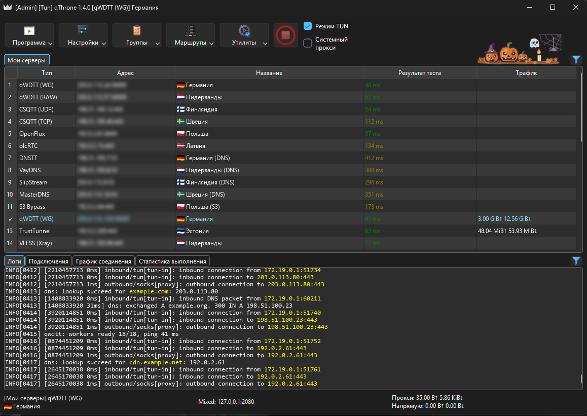

# qThrone

Клиент для Windows, Linux и macOS на ядрах [sing-box](https://github.com/SagerNet/sing-box) и [Xray](https://github.com/XTLS/Xray-core). Форк [Throne](https://github.com/throneproj/Throne).

Помимо стандартных протоколов sing-box и Xray поддерживает qWDTT, CSQTT, olcRTC, OpenFlux, DNSTT, VayDNS, SlipStream, MasterDNS и S3 Bypass - с подписками, тестом пинга и раздельной маршрутизацией.

  

## Скачать

Свежая версия - в [Releases](https://github.com/ttrroyy/qThrone/releases/latest).

- Windows: установщик `windows-universal-installer.exe` или архивы `windows64`, `windows-arm64`, `windows32`. Для старых систем - `windowslegacy64`.
- Linux: пакеты `.deb`, `.rpm`, Arch (`.pkg.tar.zst`) и архивы `linux-amd64` / `linux-arm64`. Сборки `system-qt` используют Qt из системы.
- macOS: `macos-arm64`, `macos-amd64`, для старых версий - `macoslegacy-amd64`.

Клиент сам сообщает о новых версиях.

## Особенности

**Новые протоколы.** qWDTT, CSQTT, olcRTC, OpenFlux, DNS-туннели и S3 Bypass запускаются через оригинальные клиенты этих проектов. Работают как обычные профили: с маршрутизацией, цепочками, TUN-режимом и тестом пинга. Тест пинга не рвёт текущее подключение.

**Привязка аккаунта VK.** Хеши звонков для qWDTT можно получать автоматически, CSQTT в режиме «Авто» берёт их из той же привязки. В поле хешей можно вставить и сам хеш, и полную ссылку на звонок VK.

**Деплой сервера.** Сервер qWDTT или CSQTT можно развернуть на VPS по SSH прямо из клиента и сразу получить ссылку на профиль - в том же формате, что и у оригинальных деплоев.

**Подписки.** При обновлении подписки сохраняются хеши, добавленные вручную, число воркеров и выбранные режимы WG/RAW и TCP/UDP.

**TrustTunnel.** Если QUIC недоступен, подключение переходит на HTTP/2, как в официальном клиенте.

## Протоколы

| Тип | Протоколы |
|---|---|
| Стандартные | VLESS, VMess, Trojan, Shadowsocks, SOCKS, HTTP(S), SSH |
| QUIC | Hysteria, Hysteria2, TUIC, MASQUE |
| VPN | WireGuard, AmneziaWG, OpenVPN, OpenConnect |
| Другие прокси | ShadowTLS, NaïveProxy, AnyTLS, Mieru, Snell, Juicity, TrustTunnel |
| VK и WebRTC | qWDTT, CSQTT, olcRTC, OpenFlux |
| DNS-туннели | DNSTT, VayDNS, SlipStream, MasterDNS |
| S3-хранилище | S3 Bypass |

Также поддерживаются пользовательские outbound, полные конфиги sing-box и Xray, цепочки прокси и дополнительные ядра.

## Как добавить профиль

Меню «+» в главном окне: из буфера обмена, по QR-коду с экрана или с картинки, из файла, по ссылке на подписку или вручную. Понимает ссылки всех перечисленных протоколов - в том числе `qwdtt://`, `csqtt://`, `olcrtc://`, `openflux://`, `dnst://`, `slipnet://` и `masterdns://`, - а также JSON-конфиги sing-box и Xray (S3 Bypass импортируется из Xray-конфига с outbound `fedarisha`). Из файла также добавляются конфиги MasterDnsVPN (`client_config.toml`) и профили WhiteDNS.

## Сборка

Релизы собирает CI: [`.github/workflows/build.yml`](.github/workflows/build.yml). Нативные клиенты протоколов собираются из закреплённых коммитов оригинальных репозиториев; ревизии и контрольные суммы записаны в [`transport-sources.lock.json`](transport-sources.lock.json), а `script/fetch_pinned_source.py` скачивает и проверяет исходники перед сборкой.

## Лицензия

[GPL-3.0](LICENSE). У клиентов сторонних протоколов свои лицензии - они лежат в сборке рядом с бинарниками.

## Благодарности

- Ядра: [SagerNet/sing-box](https://github.com/SagerNet/sing-box), [XTLS/Xray-core](https://github.com/XTLS/Xray-core)
- Основа клиента: [Throne](https://github.com/throneproj/Throne), [NekoRay](https://github.com/MatsuriDayo/nekoray)
- VK и WebRTC: [proxy-turn-vk-android](https://github.com/SpaceNeuroX/proxy-turn-vk-android) (qWDTT), [amurcanov/csqtt](https://github.com/amurcanov/csqtt), [olcRTC](https://github.com/openlibrecommunity/olcrtc), [OpenFlux](https://github.com/p1neappleXpress/OpenFlux)
- DNS-туннели: [dnstt](https://www.bamsoftware.com/software/dnstt/), [VayDNS](https://github.com/net2share/vaydns), [slipstream-rust](https://github.com/Mygod/slipstream-rust), [MasterDnsVPN](https://github.com/masterking32/MasterDnsVPN), [dnst-url-spec](https://github.com/net2share/dnst-url-spec), [SlipNet](https://github.com/anonvector/SlipNet), [WhiteDNS](https://github.com/WhiteDNS/WhiteDNS-Android)
- S3 Bypass и TrustTunnel: [s3-bypass](https://github.com/SpaceNeuroX/s3-bypass), [Xray-core-fedarisha](https://github.com/Fedarisha/Xray-core-fedarisha), [sing-trusttunnel](https://github.com/xchacha20-poly1305/sing-trusttunnel), [TrustTunnelClient](https://github.com/TrustTunnel/TrustTunnelClient)
- Прочее: [routeprofiles](https://github.com/throneproj/routeprofiles), [sing-box-dashboard](https://github.com/SagerNet/sing-box-dashboard)

Версия для Android - [qThroneMobile](https://github.com/ttrroyy/qThroneMobile).

## Поддержать проект

Понравилось - ставь ⭐ репозиторию: это помогает другим найти проект.

Поддержать разработку монеткой:

| Сеть | Адрес |
|---|---|
|  | `TL22P1n3JmVkhYU8RyMXfRUURx4PN6h4WZ` |
|  | `0x0B7e9f024e92f7333AB9146c0351732B959D4e9A` |
|  | `bc1qw5larutup50tdk4vuskdzep5r9ydyzt4g0c6dm` |
|  | `UQBFy4FDUovKADmWYNumVFsfgKNvI3uuzPy34fHd3sEI1R86` |
|  | [boosty.to/ttrroyy/donate](https://boosty.to/ttrroyy/donate) |
